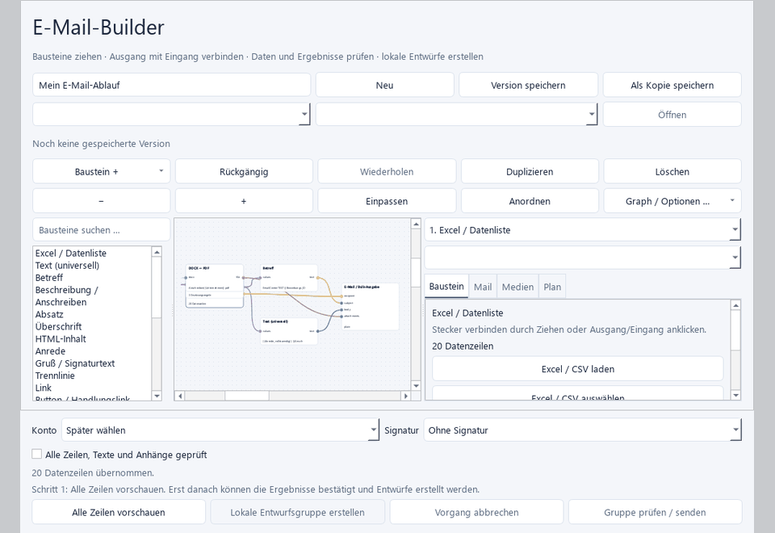
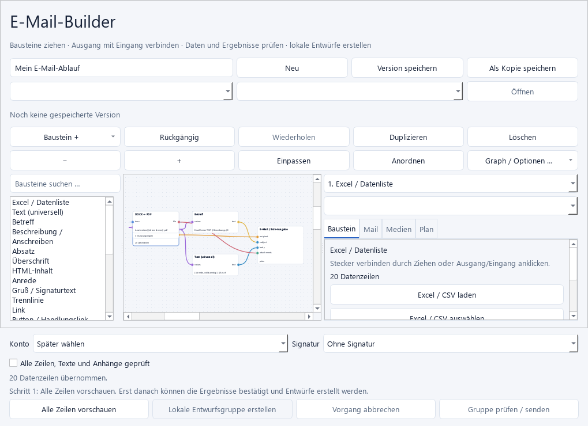
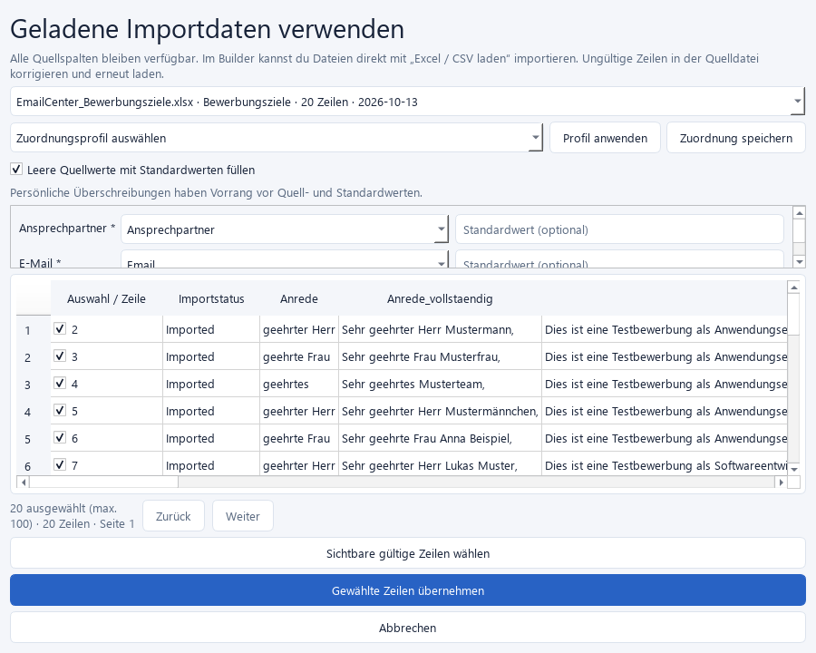
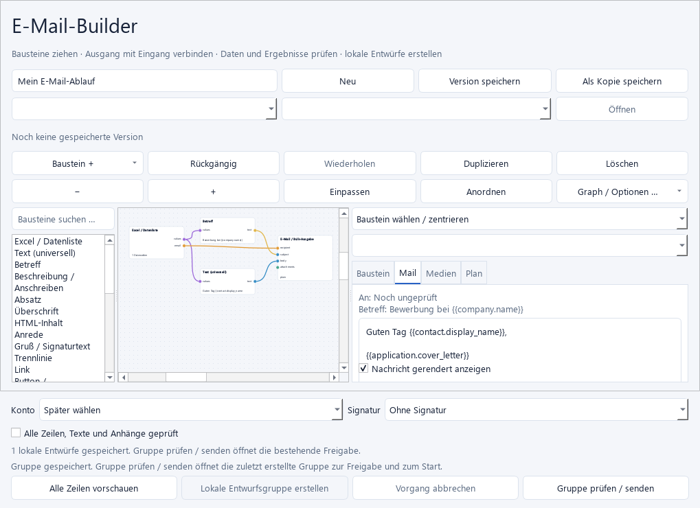
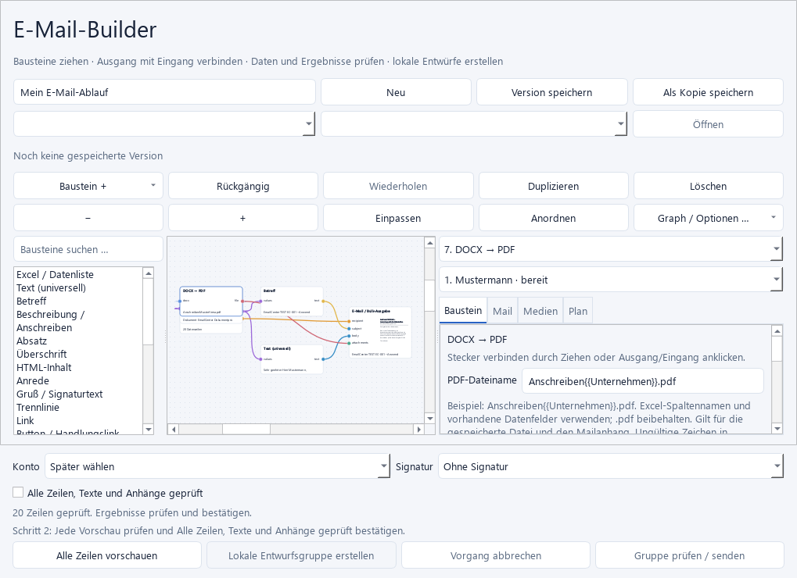
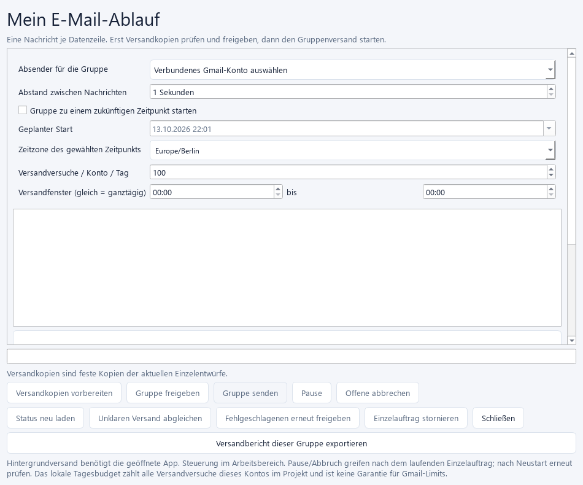
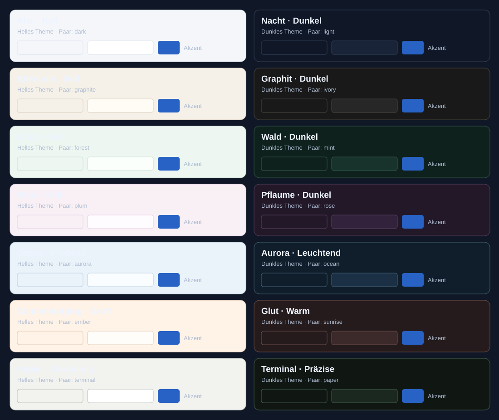

<div align="center">

# EMAILCENTER // NIGHT DRIVE EDITION

**Dein Bewerbungs- und Mail-Desk für Windows.**

*Vom Tabellen-Import bis zum geprüften Entwurf — ein klarer Workflow statt 47 offener Tabs.*

Windows Desktop · Python · Gmail OAuth · DOCX / PDF · Excel / CSV

</div>

<p align="center">
  
</p>

> Die README zeigt echte EmailCenter-Oberflächen und Demo-Daten. Die Theme-Übersicht basiert auf den Farbwerten im Programm. Es werden keine KI-generierten Illustrationen verwendet.

## Was EmailCenter macht

EmailCenter bringt Bewerbungen, Kontakte, Dokumente und E-Mail-Abläufe an einen Ort. Importiere Tabellen, baue personalisierte Dokumente und Nachrichten und prüfe jede Vorschau, bevor du Entwürfe freigibst.

| Im Cockpit | Dein nächster Schritt |
| --- | --- |
| **Kontakte & Projekte** | Bewerbungsziele, Ansprechpartner, Status und Verlauf sortieren. |
| **Excel / CSV Builder** | Spalten importieren und mit Platzhaltern im Workflow verbinden. |
| **Dokumente** | Word-Vorlagen zusammensetzen, Vorschauen prüfen und PDFs erstellen. |
| **E-Mail** | Gmail per OAuth verbinden, Entwürfe vorbereiten und Anhänge kontrollieren. |
| **Wiedervorlagen** | Erinnerungen, geplante Abläufe und Freigaben im Blick behalten. |
| **Archiv & Restore** | Vorgänge nachvollziehen und versehentlich entfernte Einträge zurückholen. |

## Der Builder in Aktion

Die folgenden Screenshots stammen aus der echten EmailCenter-Oberfläche. Tabellenzeilen und Nachrichteninhalte sind Demo-Daten.

<p align="center">
  
</p>

| Excel-Zeilen auswählen | Nachricht vor der Freigabe prüfen |
| --- | --- |
|  |  |

| PDF-Dateinamen mit Platzhaltern | Versandgruppe kontrollieren |
| --- | --- |
|  |  |

## 14 Themes. Ein Flow.

Wähle zwischen hellen und dunklen Looks — von Klar/Nacht über Minze/Wald bis Ozean/Aurora und Papier/Terminal. EmailCenter bietet außerdem Elfenbein/Graphit, Rosé/Pflaume und Sonnenaufgang/Glut. Die Farbfelder unten zeigen die echten Paletten aus dem Theme-Katalog.

<p align="center">
  
</p>

## Schnellstart

Getestet unter Windows 11 mit Python 3.13. Für DOCX-zu-PDF-Konvertierung wird LibreOffice benötigt.

```powershell
git clone https://github.com/CodeCoderCodingCode/EmailCenter.git
cd EmailCenter
py -3.13 -m venv .venv
.\.venv\Scripts\Activate.ps1
python -m pip install -r requirements.txt
python start_emailcenter.py
```

Alternativ startet `Start_EmailCenter.cmd` die Anwendung aus einer vorhandenen Projektumgebung. Ein fertiger Installer liegt nicht in diesem Quellcode-Repository.

## Gmail verbinden

Die Quellcode-Version enthält absichtlich keine Google-OAuth-Clientdatei. Für Gmail brauchst du deinen eigenen **Google Desktop OAuth Client**. Lege die Clientdatei lokal unter `json/client_secret_*.apps.googleusercontent.com.json` ab. Dateien dieses Musters werden von Git ignoriert. Im OAuth-Testmodus musst du die gewünschten Konten als Testnutzer eintragen.

Gmail-Zugangstokens speichert EmailCenter im Windows-Tresor. Geplante Versandabläufe benötigen eine geöffnete Anwendung und einen aktiven Rechner.

## Datenschutz

- OAuth-Clientdateien, `.env`-Dateien, lokale Abnahmen und generierte Ausgaben gehören nicht ins Repository.
- Nachrichten, Kontakte und Dokumente können persönliche Daten enthalten. Projektbackups sind unverschlüsselte ZIP-Dateien.
- Prüfe vor jedem Commit `git status`; lade keine echten Empfängerlisten, Nachrichten, Zugangsdaten oder privaten Dokumente hoch.

## Im Repository

- `src/emailcenter/` — Anwendung und Benutzeroberfläche
- `migrations/` — Datenbankschema und Migrationen
- `assets/templates/` — neutrale Beispieldokumente
- `tests/` — automatisierte Prüfungen
- `docs/` und `guide/` — Funktions- und Bedienungsdokumentation
- `tools/` — Entwicklungs- und Release-Helfer

<div align="center">

**EmailCenter — klare Abläufe. Saubere Entwürfe. Zurück in den Flow.**

</div>
