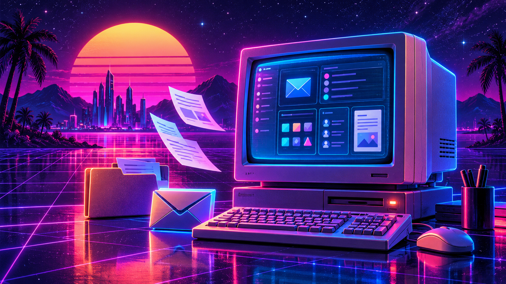
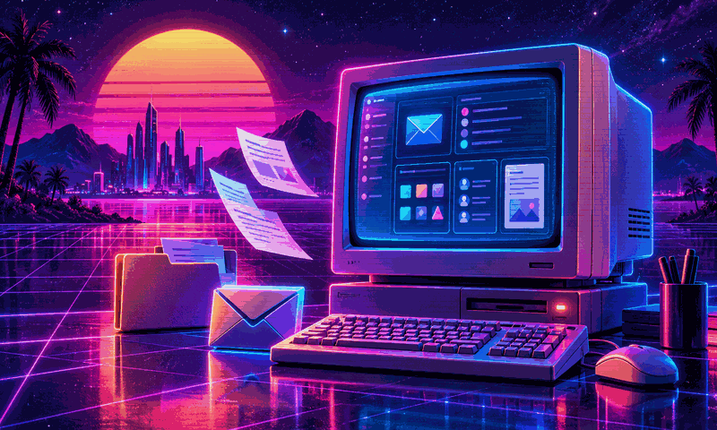

# 📼 EMAILCENTER

<div align="center">
  
  <h2>Dein Bewerbungs- und Mail-Desk. Zurück in die Zukunft.</h2>
  <p><strong>Weniger Postfach-Chaos. Mehr Fokus auf den nächsten Schritt.</strong></p>
  <p>Windows Desktop · Python · Gmail OAuth · DOCX / PDF · Excel / CSV</p>
</div>

<p align="center">
  
</p>

> **Heads-up:** Header und Loop sind atmosphärische Illustrationen, keine Screenshots der echten Oberfläche.

EmailCenter bündelt Kontakte, Bewerbungen, Dokumente und E-Mail-Abläufe in einer Windows-Anwendung. Von der Excel-Zeile bis zum fertigen PDF-Anhang bleibt der Workflow an einem Ort — mit Vorschau und Freigabeschritten, bevor etwas versendet wird.

## ✨ Was im Cockpit steckt

| Bereich | Was du damit machst |
| --- | --- |
| **Kontakte & Projekte** | Bewerbungsziele, Ansprechpartner, Status und Verlauf geordnet verwalten. |
| **Excel / CSV Builder** | Tabellen importieren und Spalten als Platzhalter für personalisierte Dokumente nutzen. |
| **Dokumente** | Word-Vorlagen mit Bausteinen zusammensetzen, Vorschauen prüfen und PDFs erzeugen. |
| **E-Mail** | Gmail per OAuth verbinden, Entwürfe vorbereiten und Anhänge vor dem Versand kontrollieren. |
| **Wiedervorlagen** | Erinnerungen, geplante Abläufe und offene Freigaben im Blick behalten. |
| **Archiv & Wiederherstellung** | Dokumente und Vorgänge nachvollziehen und versehentlich entfernte Einträge zurückholen. |

## 🚀 Schnellstart aus dem Quellcode

Getestet wurde der Entwicklungsstand unter Windows 11 mit Python 3.13. Für echte DOCX-zu-PDF-Konvertierung wird außerdem LibreOffice benötigt.

```powershell
git clone https://github.com/CodeCoderCodingCode/EmailCenter.git
cd EmailCenter
py -3.13 -m venv .venv
.\.venv\Scripts\Activate.ps1
python -m pip install -r requirements.txt
python start_emailcenter.py
```

Alternativ startet `Start_EmailCenter.cmd` die Anwendung aus der vorhandenen Projektumgebung. Ein fertiger Installer ist in diesem Quellcode-Repository nicht enthalten.

## 📬 Gmail verbinden

Die Quellcode-Version enthält absichtlich keine Google-OAuth-Clientdatei. Für die Gmail-Verbindung brauchst du deinen eigenen **Google Desktop OAuth Client**. Lege die Clientdatei lokal unter `json/client_secret_*.apps.googleusercontent.com.json` ab und ergänze bei einer OAuth-App im Testmodus die gewünschten Konten als Testnutzer. Diese Datei wird von Git ignoriert.

Gmail-Zugangstokens werden im Windows-Tresor gespeichert. Hintergrund- und Terminversand brauchen eine geöffnete Anwendung und einen aktiven Rechner.

## 🔐 Datenschutz & lokale Daten

- OAuth-Clientdateien, `.env`-Dateien, generierte Ausgaben und lokale Abnahmen gehören nicht in dieses Repository.
- Persönliche Projekte können Nachrichten, Kontakte und Dokumente enthalten. Projektbackups sind unverschlüsselte ZIP-Dateien — behandle sie wie die Originaldaten.
- Prüfe vor jedem Commit `git status` und lade keine echten Empfängerlisten, Nachrichten, Zugangsdaten oder privaten Dokumente hoch.

## 🧭 Im Repository

- `src/emailcenter/` — Anwendung und Benutzeroberfläche
- `migrations/` — Datenbankschema und Migrationen
- `assets/templates/` — neutrale Beispieldokumente
- `tests/` — automatisierte Prüfungen
- `docs/` und `guide/` — Funktions- und Bedienungsdokumentation
- `tools/` — Entwicklungs- und Release-Helfer

## 🪩 Der Vibe

Dunkler Bildschirm. Neon am Horizont. Ein klarer nächster Schritt. **EmailCenter** bringt Ordnung in den Bewerbungsflow — ganz ohne 47 offene Tabs.
