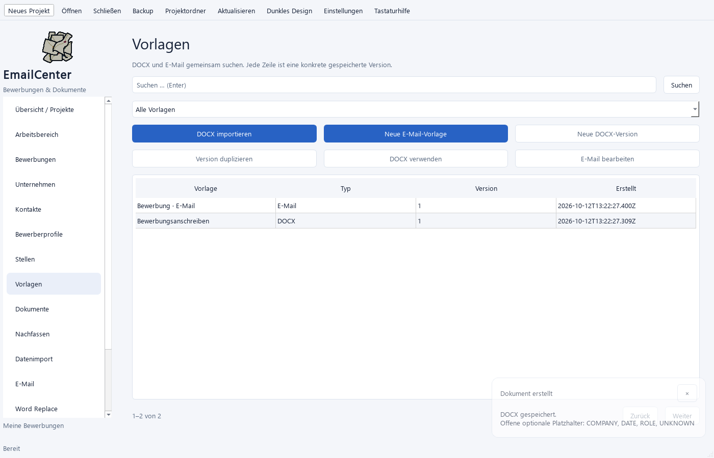
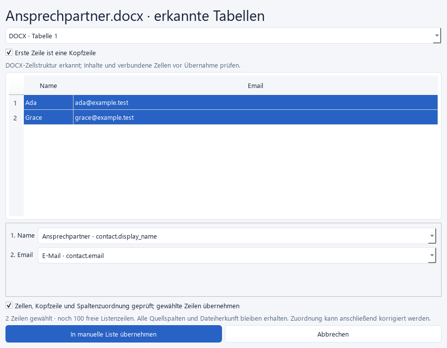
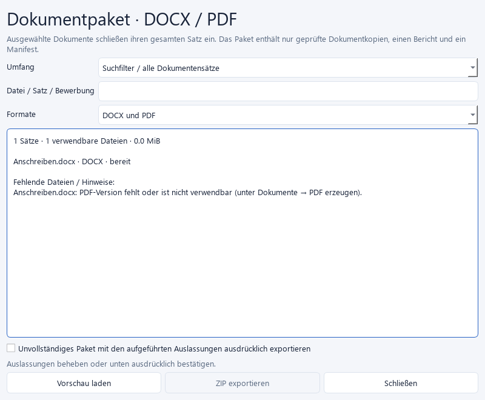

# Ausbaupaket – OAuth, Vorlagen, Datenquellen, Export und Hotkeys

Stand: 12.10.2026. Alle beauftragten Implementierungen sind fertig. Die
manuelle [Sammelabnahme](25_Bundled_Acceptance.md) bleibt offen. Danach wurde
der nächste Builder-Punkt, Graphtransfer, umgesetzt.

## OAuth und Logo

Die Browserseite zeigt „Google-Rückmeldung erhalten“ und verweist zur Prüfung
des Abschlusses auf die App. Erst diese bestätigt die gespeicherte Kontoverbindung.
Die Seite enthält Hell/Dunkel, mobile Breite, sichtbaren Tastaturfokus sowie
„Tab schließen“. Blockiert der Browser das Schließen, erscheint die Anleitung
mit Tab-×/Strg+W; ohne JavaScript ist sie ebenfalls verfügbar.

Der Loopback-Listener bindet ausschließlich 127.0.0.1 auf einem freien Port mit
exklusiver Windows-Bindung. Er prüft Pfad, Methode und OAuth-State und ignoriert
ungültige Rückmeldungen bis zum Zeitlimit. PKCE und Scope-Prüfung bleiben aktiv.
Die Seite zeigt keine Codes/Tokens, entfernt die Rückmeldeparameter aus der
sichtbaren URL und lädt keine externen Ressourcen. Fehler melden Abbruch.

`assets/Logo256.png` wird als App-/Fenstericon, Marke in der Seitenleiste und
eingebettetes Browserlogo verwendet. Die sichtbaren Marken skalieren ohne Glättung.
Es ist eine Rastergrafik: ganze Vergrößerungsfaktoren erhalten die Pixelstruktur;
beliebige Größen besitzen keine zusätzlichen Bilddetails.

[Lokale HTML-Vorschau](oauth_completion_preview.html) – der tatsächliche Browserablauf
und das Schließen bleiben Teil der manuellen Abnahme.

## Gemeinsame Vorlagen

Unter **Vorlagen** suchen DOCX und E-Mail gemeinsam. **Alle/DOCX/E-Mail** filtert
die Versionen. Die Aktionen richten sich nach dem Typ. Eine konkrete ältere
Mailfassung öffnet sich im Editor; Speichern legt eine neue Fassung an.

**Version duplizieren** erzeugt eine unabhängige DOCX- oder Mailvorlage. Bei DOCX
werden Inhalt, Mapping, Pflichtwerte und Beschreibung übernommen. Dateiprüfung
und eine geprüfte Kopie schützen die gewählte Version auch während des Duplizierens.

Mailvorlagen zeigen während der Eingabe eine gerenderte Text-/HTML-Ansicht.
Die persönliche Vorschau hat **Nachricht/Quelltext** als Tabs. Fehlende Werte
oder Änderungen sperren die Übernahme bis zur erneuten Prüfung. Externe Ressourcen
bleiben blockiert. Die Qt-Darstellung praktisch mit Gmail/Outlook vergleichen.

## Tabellen aus Dokumenten

In einer **manuellen Liste** für Bulk, Word Replace oder Builder **DOCX-/PDF-Tabelle
laden** verwenden. Bei PDF Zelllinien oder Textspalten wählen. Im Prüfdialog:

1. Tabelle wählen, erste Zeile als Kopfzeile behandeln oder als Daten erhalten.
2. Benötigte Zeilen auswählen, insgesamt maximal 100 Listenzeilen.
3. Quellspalten ausdrücklich auf Ansprechpartner, E-Mail, Firma, Anschreiben
   oder ein eigenes Feld zuordnen; keine automatische Personen-/Firmenzuordnung.
4. Zellen und Erkennung bestätigen; anschließend in der Liste korrigieren/speichern.

Alle Rohspalten/Kopfzeilen bleiben unter `document.*` erhalten. `source.*` enthält
Dateiname, SHA256, Tabelle, Seite und Zeile des erkannten Tabellenrasters.
PDF-Erkennung ist als unsicher markiert, verbundene DOCX-Zellen besitzen Hinweise.
Scans benötigen vorher OCR. Grenzen: 20 MiB, 50 PDF-Seiten/Tabellen, 1000
Vorschauzeilen je Tabelle, 30 Spalten. Abbruch/Fehler verändert keine vorhandene Liste.

PDF-Erkennung verwendet die dokumentierten Linien-/Textstrategien von
[pdfplumber](https://github.com/jsvine/pdfplumber#extracting-tables); die
Projektabhängigkeit ist auf Version 0.11.10 festgelegt.

## Dokumentpakete

**Dokumente → Dokumentpaket exportieren** oder die entsprechende Aktion im
allgemeinen Export öffnen. Filter über Datei/Satz/Bewerbung oder die Sätze
ausgewählter Dokumente wählen. Auswahl schließt ihre Formatvarianten mit ein.

DOCX/PDF/beide wählen, Vorschau prüfen. Fehlende oder veränderte Dateien und fehlende
PDF-Versionen werden aufgeführt. PDFs unter Dokumente erzeugen oder ein Paket mit
den aufgeführten Auslassungen ausdrücklich bestätigen. ZIP enthält Satzordner,
`manifest.json` und `Exportbericht.txt`. Dateiinhalte werden vor/während des Kopierens
geprüft, veränderte Vorschauen abgewiesen. Abbruch/Fehler erhält bestehendes Ziel.

Grenzen: 1000 Dokumente, 100 MiB je Datei, 1 GiB Paketinhalt. Innerhalb des Projekts
unter `exports` speichern; Export-Einstellungen bestimmen den Standardordner.

## Canvas-Hotkeys und Graphtransfer

**Einstellungen → Hotkeys** besitzt getrennte App- und Canvas-Belegungen.
Canvas-Kürzel wirken nur bei Zeichenflächenfokus, unterstützen Deaktivierung,
Konfliktprüfung, Standardwerte und dauerhafte Speicherung.

| Standard | Aktion |
|---|---|
| Alt+Right/Left | Baustein wählen |
| Alt+Down/Up | Stecker wählen |
| Return | Ausgang aktivieren / mit Eingang verbinden |
| Escape | Verbindung und Auswahl abbrechen |
| Alt+E, danach Delete | Verbindung wählen und löschen |
| Ctrl+D, Ctrl+Z/Y | Duplizieren, Rückgängig/Wiederholen |
| Ctrl+Up/Down, Ctrl+0 | Zoom / Einpassen |

Ausgang wählen/aktivieren → Zielbaustein/Eingang wählen → erneut aktivieren.
Steckertypen, belegte Eingänge und Kreise werden wie beim Mausablauf geprüft.
Textfelder behalten ihre eigenen Kürzel. F1 zeigt die aktuellen Belegungen.

**Graph / Optionen** importiert/exportiert portable JSON-Vorlagen. Texte, Regeln,
Positionen und Verbindungen bleiben enthalten. Datenzeilen und Dateipfade werden
neu zugeordnet. Vor Weitergabe enthaltene Texte prüfen. Import zeigt den Umfang
und verlangt ausdrückliche Übernahme. Ablehnen oder Fehler erhält den aktuellen
Editor. Übernahme startet einen unabhängigen Ablauf mit neuer Konto-/Signatur-/
Planungswahl und neuer Vorschau; alte gespeicherte Versionen bleiben erhalten.

## Automatische Prüfung

Gesamtsuite: **482 Tests, 481 bestanden, ein optionaler nativer Windows-Vault-Test
übersprungen**. 33 neue Prüfungen: 23 Kern/10 Qt für OAuth/Loopback, Vorlagen,
DOCX-/PDF-Tabellen, ZIP-Pakete, Canvas-Hotkeys, ältere Einstellungsdateien und
Graphtransfer. Dateiveränderungen, Abbruch, Fehler und erhaltene Eingaben sind geprüft.
Die Qt-Ansichten wurden erzeugt und angesehen; echte Browser-/Windows-/Gmail-/
LibreOffice-Abnahmen bleiben im Paket H offen.
