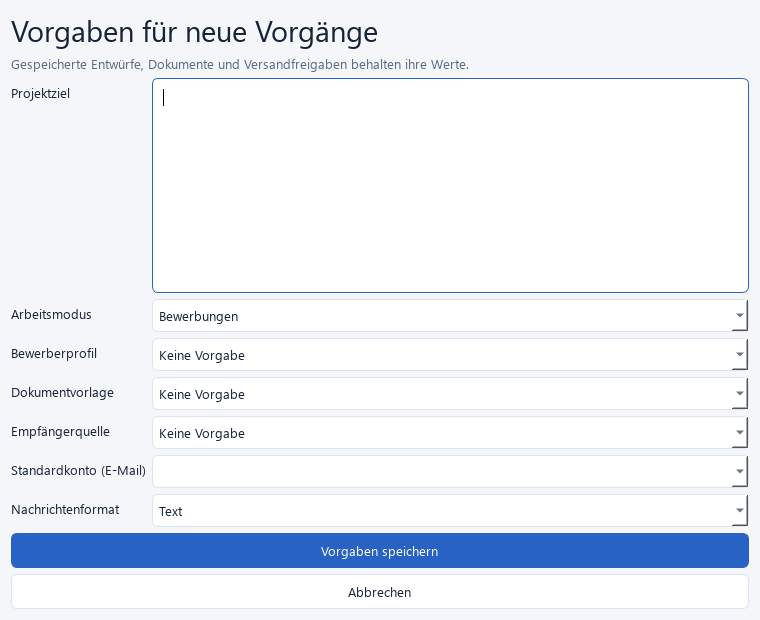
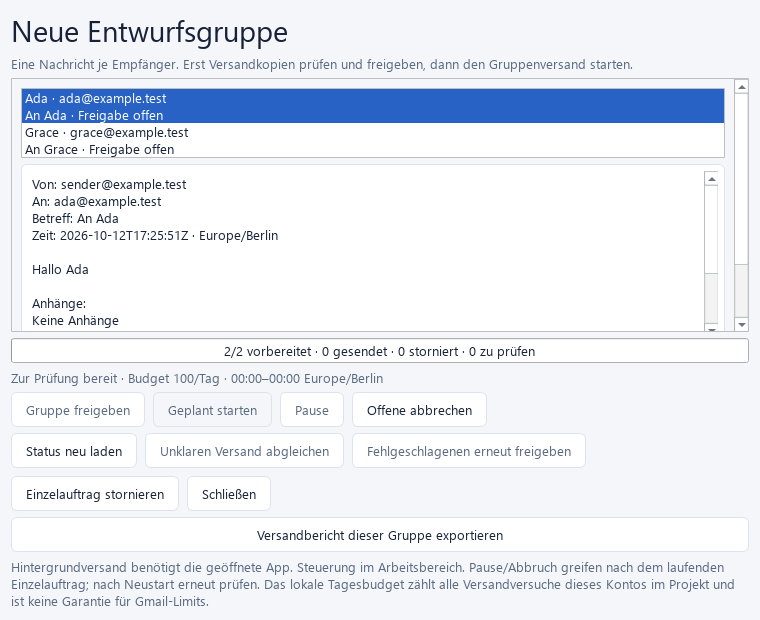
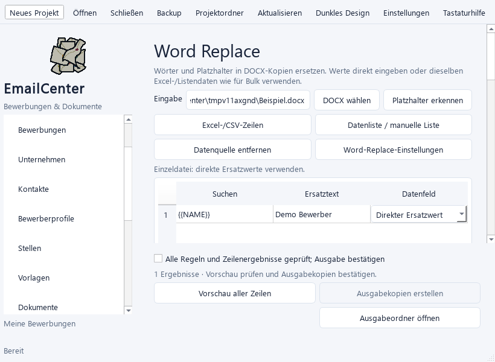
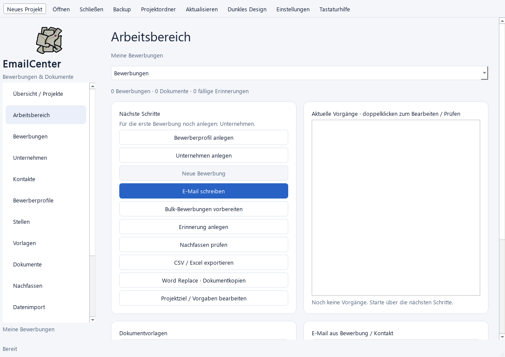
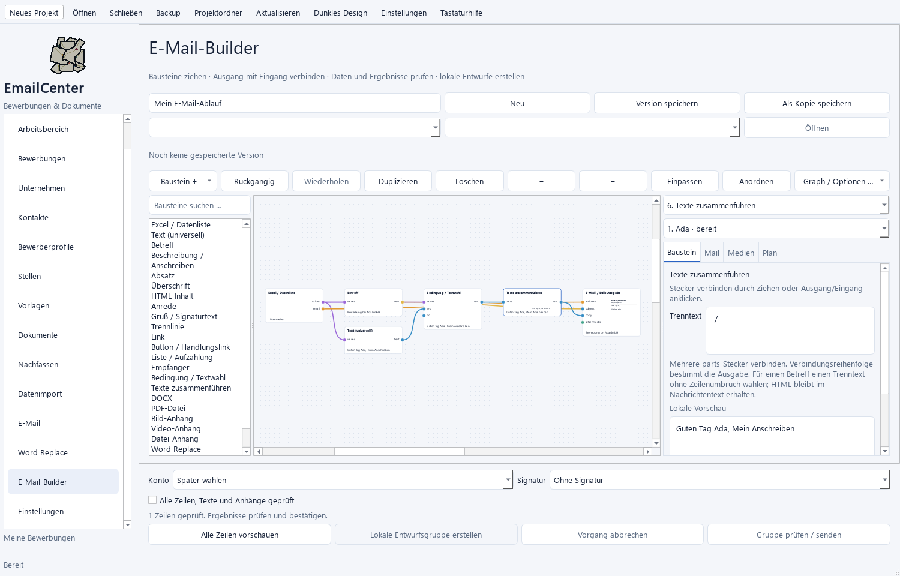

# Sprint 7 – Projektvorgaben, Bulk, Word Replace und UI

Stand: 12.10.2026. Die angeforderten Implementierungen aus den Abschnitten 2,
4, 4B und 6 sind vorhanden. Praktische Abnahmen stehen gesammelt in
[Paket I](25_Bundled_Acceptance.md). Danach wurden zwei weitere Builder-Bausteine ergänzt.

## 1. Projekt anlegen und Vorgaben bearbeiten

Der Assistent bietet zusätzlich zum Ziel, Arbeitsmodus, Profil und der Signatur:

- Ein vorhandenes Bewerberprofil aus dem geöffneten Projekt übernehmen.
  Adress- und Zusatzfelder bleiben in der eigenen Kopie erhalten.
- Eine konkrete DOCX-Vorlagenversion übernehmen oder eine externe DOCX wählen.
  Version, Feldzuordnung und Pflichtwerte werden kopiert; beim Kopieren geänderte
  Dateien verhindern die Anlage.
- Eine gespeicherte Empfängerliste als unabhängige Liste übernehmen.
- Eine bevorzugte Gmail-Adresse und Text/HTML als Nachrichtenformat angeben.

„Projektziel / Vorgaben bearbeiten“ im Arbeitsbereich ergänzt oder ändert diese
Angaben später. Gelöschte Vorlagen/Profile werden nicht weiter vorgeschlagen.
Ein gleichzeitig geänderter Stand verhindert das Überschreiben.

Die Vorgaben füllen neue Bewerbungen, Einzelentwürfe, Bulk-Auswahl und neue
Builder-Abläufe vor. Die Empfängerliste wird beim Öffnen des Bulk-Editors geladen.
Die Gmail-Adresse wird nur einem bereits verbundenen, aktivierten Konto zugeordnet;
die Angabe allein verbindet kein Konto. Bestehende Entwürfe, Graphversionen und
freigegebene Versandkopien behalten ihre gespeicherten Angaben.

## 2. Empfänger und persönliche Bewerbungen

Im Bulk-Editor können ausgewählte Projektkontakte als Gruppe gespeichert werden.
Ein gespeicherter Filter enthält Suche, optional die Gruppe und „Nur gültige
Adressen“. Auswahl über Seiten bleibt erhalten. Löschen einer Gruppe entfernt
die Gruppenzuordnung; die Kontakte bleiben bestehen. Manuelle/Excel-Zeilen bleiben
in den gemeinsamen Datenlisten und werden nicht automatisch zu Kontaktgruppen.

Je Empfänger stehen zusätzlich zur gemeinsamen DOCX-Version bereit:

- „Gruppenvorlage übernehmen“, eine andere konkrete Version oder kein Anschreiben.
- Eigene Dokumentwerte, persönliche Anhänge und eine vorhandene Bewerbung.
- Optional „Neue Bewerbung anlegen“. Die Vorschau zeigt die Anlage an; erst beim
  Speichern der gesamten Entwurfsgruppe entstehen die Datensätze und Dokumente.

Die neue Bewerbung verwendet die ausdrücklichen Zeilenwerte für Name, Anrede,
Firma, Stelle, Anschreiben und weitere Felder. Ein gewähltes Projektprofil ergänzt
fehlende Profilwerte. Firmen/Stellen werden unabhängig angelegt, wenn diese Werte
ausdrücklich vorhanden sind; gleiche Namen führen nicht zu einer stillen Zusammenführung.
Datei- oder Datenbankfehler nehmen die Gruppenanlage vollständig zurück.

Bewerbungen zeigen den zugehörigen Mailstatus an. Erst ein bestätigter Versandbeleg
setzt einen frühen Bewerbungsstatus auf „Versendet“. „Gespräch“, „Angebot“ und spätere
fachliche Status bleiben erhalten; der Mailstatus wird trotzdem aktualisiert.

## 3. Versandfenster, Budget und Hintergrund

Vor der Vorbereitung der festen Versandkopien wählen:

1. Absender, Starttermin/Zeitzone und Abstand zwischen Nachrichten.
2. Tagesbudget von 1–10000 Versandversuchen; Standard 100.
3. Lokales Versandfenster. Gleiche Start-/Endzeit bedeutet den ganzen Tag;
   22:00–06:00 ist ein Fenster über Mitternacht.
4. Nachrichten prüfen, gemeinsam freigeben und den Start ausdrücklich bestätigen.

Das Tagesbudget zählt alle protokollierten Versandversuche dieses Kontos im
aktuellen Projekt, einschließlich Einzelaufträgen und fehlgeschlagenen Versuchen.
Die Zeitzone des Gruppenplans bestimmt den Kalendertag. Andere Projekte oder
außerhalb von EmailCenter gesendete Nachrichten können darin nicht gezählt werden.
Jede Gruppe verwendet ihr gewähltes Budget. Es garantiert kein verfügbares Gmail-Limit.

Vor dem nächsten Versand werden Termin, Abstand, Tagesbudget, Fenster und eine
gespeicherte Anbietersperre geprüft. Warten verbraucht keinen Versandversuch.
Bei erkannten Gmail-Quotenfehlern wird eine Sperrzeit gespeichert. Ein unklarer
Versand, etwa nach HTTP 429, braucht Abgleich und wird nicht automatisch wiederholt.
Referenz zu den Anbieterfehlern: [Google Gmail API](https://developers.google.com/workspace/gmail/api/guides/handle-errors).

„Bei geöffneter App im Hintergrund ausführen“ erlaubt das Schließen des
Gruppenfensters. Im Arbeitsbereich bleiben Prüfen/Fortsetzen, Pause und Abbruch
erreichbar. Pause/Abbruch während einer laufenden Netzwerkanfrage greifen danach.
Die App muss geöffnet bleiben. Nach Neustart, Projektwechsel oder längerer
Unterbrechung wird pausiert und erneut geprüft; gesendete Aufträge bleiben erledigt.
Der Hintergrundlauf verwendet dieselben festen Kopien und Freigaben.

Der normale Versand im Gruppenfenster pausiert beim Schließen weiterhin.
Es gibt keinen Versanddienst bei geschlossener App.

## 4. Word Replace – gespeicherte Läufe

Neben Suchoptionen und DOCX/PDF-Ausgabe gibt es Ersatzformatierungen:
ersten Text-Run übernehmen, Absatzstandard, Fett oder Kursiv. Die neue Formatierung
gilt für den Ersatz; Text davor/danach behält seine vorhandene Formatierung.

Dateinamensmuster können dauerhaft unter Einstellungen → Word Replace gespeichert
werden. Beispiel: `{prefix}-{number:03d}-{company.name}-{name}`.
`prefix`, `number`, `name` und ausdrücklich vorhandene Datenfelder sind möglich.
Ungültige Zeichen in Feldwerten werden ersetzt; Pfade, beliebige Formatcodes oder doppelte
Ausgaben werden abgewiesen. Ein leeres Muster verwendet die bisherige Benennung.

Nach neuer Vorschau und Bestätigung entsteht ein gespeicherter Lauf mit einer
Originalkopie, den festen Regeln und allen Zeilenwerten. Die Oberfläche verarbeitet
jeweils eine Ausgabe und zeigt den Fortschritt. „Abbrechen“ hält den Lauf an.
Bereits fertige Ausgaben bleiben erhalten. Ein unterbrochener Lauf kann über
„Gespeicherte Läufe“ geladen und ausdrücklich fortgesetzt werden.

Bei Wiederaufnahme werden Originalkopie und fertige Ausgaben anhand ihrer
Prüfsummen kontrolliert. Spätere Änderungen an Excel, Listen oder dem externen
Original ändern diesen Lauf nicht. Geänderte fertige Dateien werden erhalten und
verhindern die Fortsetzung; bei anderen Daten/Regeln einen neuen Lauf anlegen.

Die Veröffentlichung speichert je Ausgabe einen Beleg. Ein Prozessabbruch nach
Dateiveröffentlichung kann dadurch abgeschlossen werden, ohne die Datei erneut
zu erzeugen oder ein zweites Dokument zu registrieren. Ein lebender Laufbesitzer
sperrt gleichzeitige Verarbeitung in einem weiteren Fenster. Nach einem beendeten
lokalen Prozess kann die Arbeit wieder aufgenommen werden. Ein Besitzer auf einem
anderen Rechner oder ein nicht prüfbarer Prozess wird vorsichtig als aktiv behandelt.

Originale und registrierte Dokumente werden nicht überschrieben. Andere vorhandene
Ziele brauchen ausdrückliche Bestätigung und müssen beim Veröffentlichen noch
dem geprüften Ausgangsstand entsprechen. Interne Laufkopien und gegebenenfalls
gesicherte alte Zielstände liegen unter `exports/word_replace_runs` im Projekt.
Die frühere Servicefunktion für atomare Gesamtausgabe bleibt separat erhalten;
die Oberfläche verwendet den fortsetzbaren Ablauf mit erhaltenen Teilergebnissen.

## 5. Bedienung und Einstellungen

- Modusabhängige Bulk-Aktion und passende Kontextauswahl direkt im Arbeitsbereich.
- Umbruch von Aktionsleisten in E-Mail, Bulk, Quellen, Vorlagen, Export und Word Replace.
  Scrollbare Formulare und kompakte Feldanordnung bei schmalen Fenstern.
- Fortschritt für mehrzeilige Bulk-/Word-Vorgänge; erreichbarer Abbruch auch bei
  Dokumentvorschau und PDF-Erzeugung. Ein isolierter PDF-Konverter wird bei Abbruch
  beendet; das Quelldokument bleibt erhalten.
- Builder-Palette/Eigenschaften ein-/ausblenden, Breiten speichern und kompakte
  Werkzeugbeschriftungen einschalten: „Graph / Optionen“ und Einstellungen → Builder.
- Kurze Übergänge bei Seite/Design. „Reduzierte Bewegung“ deaktiviert Übergänge
  und Toastanimationen. Fokus, Formularwerte und Graphen bleiben erhalten.
- Toasts mit Erfolg, Info, Hinweis oder Fehler. Dauer 2–30 Sekunden; Info/Erfolg
  getrennt abschaltbar. Anhaltende Fehler werden geschlossen und nicht durch eine
  spätere Erfolgsmeldung verdrängt.

## 6. Danach: Bedingungen und Zusammenführen im Builder

„Bedingung / Textwahl“ benötigt einen `values`-Eingang. Datenfeld und Prüfung
wählen: gleich/ungleich, enthält, leer oder ausgefüllt. Groß-/Kleinschreibung ist
einstellbar. `yes` und `no` nehmen verbundene Textbausteine an; ohne Verbindung
wird der entsprechende Ersatztext verwendet. Nur der gewählte Text braucht seine
persönlichen Platzhalterwerte. Die Prüfung führt keine Ausdrücke oder Programme aus.

„Texte zusammenführen“ erhält mehrere `parts`-Verbindungen. Die Reihenfolge der
Verbindungen und ein einstellbarer Trenntext bestimmen die Ausgabe. Für Betreff
keine Zeilenumbrüche verwenden; bei HTML-Nachrichten bleiben HTML-Teile erhalten,
während Datenwerte und Trenntext maskiert werden. Textbedingungen wählen keine
Anhänge und unterdrücken keinen Versandauftrag.

Die persönlichen Ergebnisse erscheinen nach Zeilenprüfung im Baustein und in der
fertigen Nachricht. Vor der Prüfung zeigt der Live-Renderer den noch ungeprüften
Textwahl-Baustein als Hinweis. Jede Änderung verlangt eine neue Vorschau/Freigabe.
Beide Bausteine gehören zu Versionen, Autosicherung und portablen Graphvorlagen.
Wiederverwendbare Bausteingruppen, Inline-Medien und DOCX-Seitenlayout bleiben offen.

## Technik und Prüfung

Migration 011 ergänzt Empfängergruppen/-filter, Versandrichtlinien/Anbietersperren,
Bewerbungs-Mailbelege und Word-Replace-Läufe. Vorhandene Aufträge, Freigaben und
Versandkopien bleiben erhalten; eine Migration startet keinen Versand.

Neue Tests prüfen Projektanlage/Vorgaben, Gruppen/Filter, persönliche DOCX-Versionen,
Domain-Bewerbungen/Mailstatus, Budget/Fenster/Quoten, Hintergrundsteuerung, Laufbesitz,
Abbruch/Wiederaufnahme, Textwahl und UI. Es werden ausschließlich Testprovider und
isolierte Projekte verwendet. Den geprüften Gesamtstand nennt
[START HERE](../README_START_HERE.txt); reale Abnahmen bleiben in der Sammelliste offen.

Prüfergebnis: 530 Tests, 529 bestanden, ein optionaler nativer Windows-Vault-Test
übersprungen. Nach der abschließenden Kürzung der Word-Tabellenköpfe nochmals
36 betroffene Kern-/UI-Tests bestanden. 48 neue Paketprüfungen, darunter 17 Qt.
