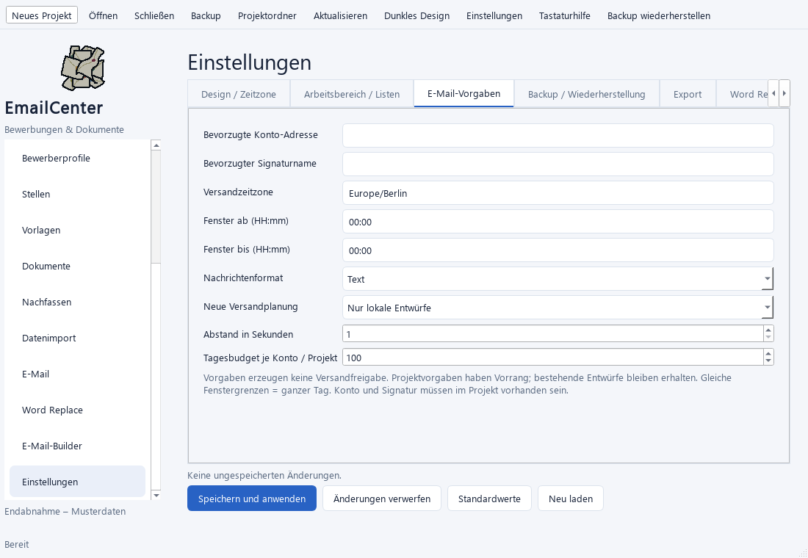
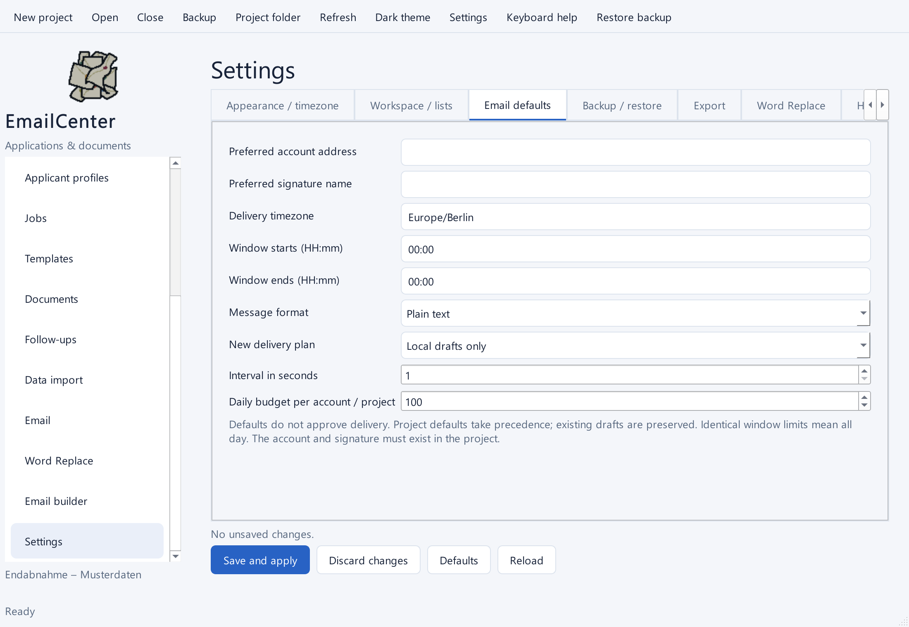

# Endspurt – Sprint 7B / 8

Stand: 12.10.2026. Implementierung und automatische Prüfungen sind abgeschlossen;
die gebündelte praktische Abnahme bleibt separat offen.

## Fertige Funktionen

| Bereich | Umsetzung |
| --- | --- |
| Sprache | DE/EN dauerhaft speichern; Navigation, Werkzeugleisten und zentrale Einstellungen übersetzen. Weitere Fachtexte und Fehlermeldungen sind teilweise deutsch. |
| Arbeitsbereich | Standardmodus neuer Projekte und Startansicht Übersicht, Arbeitsbereich, Builder oder Word Replace einstellen. |
| E-Mail | Bevorzugte Konto-Adresse und Signaturname, Text/HTML, Zeitzone, Entwürfe/Direkt-/Terminplanung, Abstand, Tagesbudget und Versandfenster speichern. |
| Listen | Datensatzlisten mit 10–200 Zeilen, wechselnden Zeilenfarben, Textumbruch und kompakter Ansicht konfigurieren. Spezielle Mail-/Quellenlisten behalten ihre eigene Seitengröße. |
| Builder | Neun Arten von Text-/Nachrichtenbausteinen als Vorgabe auswählen und per Drag & Drop ordnen. Datenquelle, Betreff und E-Mail werden immer angelegt. |
| Builder-Historie | Undo/Redo des Graphen im Arbeitsstand speichern und nach Neustart wiederherstellen; bis zu 100 Einträge und begrenzte Dateigröße je Historie. |
| Backup | Zielordner und Aufbewahrung einstellen; neue Archive enthalten Dateigrößen und SHA-256-Prüfsummen. |
| Wiederherstellung | Archiv prüfen, Abbruch erlauben und ausschließlich in einen neuen Projektordner wiederherstellen. Originalprojekt bleibt geöffnet. |
| Diagnose | Lokalen JSON-Bericht über Versionen, Datenbankzustand und Statuszahlen exportieren; keine Nachrichten, Adressen, Dateipfade oder Zugangsdaten aufnehmen. |

E-Mail-Vorgaben erteilen keine Versandfreigabe. Projektvorgaben haben Vorrang;
bestehende Entwürfe und feste Versandaufträge werden nicht umgeschrieben.
Das Tagesbudget gilt je Konto innerhalb des jeweiligen Projekts.

## Bedienung und gemeinsame Abnahme

1. Unter **Einstellungen → Arbeitsbereich / Listen** Sprache, Standardmodus,
   Startansicht und Listenoptionen ändern, speichern und die App neu starten.
2. Unter **E-Mail-Vorgaben** ein bereits im Projekt verbundenes Konto und eine
   vorhandene Signatur nennen. Einen neuen Entwurf und eine neue Bulk-Planung
   öffnen und die übernommenen Werte prüfen.
3. Unter **Builder** mehrere Standardbausteine wählen und ordnen. Einen neuen
   Graphen anlegen, Bausteine ändern, Undo ausführen, Projekt schließen/öffnen
   und Undo/Redo erneut verwenden. Historie stellt keine Versandfreigabe wieder her.
4. Unter **Backup / Wiederherstellung** Ziel und Aufbewahrung einstellen.
   Backup erstellen und über **Backup wiederherstellen** in einen neuen Ordner
   kopieren. Alte Archive ohne Prüfsummen werden ausdrücklich gekennzeichnet.
5. Das wiederhergestellte Projekt öffnen: Gmail-Konten sind deaktiviert,
   Versandaufträge benötigen erneute Prüfung, Hintergrundläufe starten nicht.
   Alte Word-Replace-Ausgabeziele werden vor erneutem Schreiben gesperrt;
   nach Kontrolle einen neuen Lauf mit neuem Ziel anlegen.
6. Diagnosebericht lokal exportieren und Inhalt prüfen.

Aufbewahrung entfernt ausschließlich unveränderte, bekannte und verifizierte
Archive desselben Projekts im gewählten Ziel. **0** bewahrt alle Archive auf.
Wiederherstellung prüft Archiveinträge, Prüfsummen, Datenbankintegrität und
Fremdschlüssel; bestehende Zielordner werden abgelehnt. Versandversuche mit
unklarem Ausgang bleiben unklar und werden nicht automatisch wiederholt.

## Datenschutz und Speicherung

Projektarchive enthalten die lokale Datenbank, Dokumente, Vorlagen, Importe und
Exporte; darunter können persönliche Nachrichten und Bewerbungsdaten sein.
Gmail-Tokens liegen im Windows Credential Manager und gehören nicht ins Archiv.
Globale Einstellungen liegen außerhalb des Projekts und werden nicht mitgesichert.
Diagnoseexport erfolgt nur auf Anforderung in einen lokalen Ordner.

## Prüfergebnis und offene Punkte

- Gesamtlauf: **561 Tests, 560 bestanden, ein optionaler nativer Vault-Test übersprungen**.
- 31 neue Endspurt-Prüfungen: 20 Kern- und 11 Qt-Tests.
- Qt-Skalierungen 100/125/150/200 % und Navigation mit simulierten Tastaturereignissen geprüft.
- Die abgebildeten Ansichten wurden nach Ende der Seitenanimation kontrolliert.
- Echte Windows-Skalierung und physische Tastaturbedienung bleiben offen.
  Das native Automationswerkzeug konnte wegen fehlender Kernel-Dateien nicht starten.
- Echter DOCX→PDF-Lauf und Seitenlayout bleiben offen: LibreOffice wurde weder
  im PATH noch an den üblichen Installationsorten gefunden.
- Gmail-Test am 12.10.2026 erfolgreich: zwei ausdrücklich freigegebene Nachrichten
  ohne Anhänge an die Hauptadresse und den Plus-Alias gesendet. **Completed,
  2 Versandversuche, 2 Sent-Aufträge mit Gmail-Nachrichtenkennungen.**
  Das geschlossene Versandfenster verursachte null Versandversuche. Der reale
  Hintergrundablauf wurde abgeschlossen; die Budgetprüfung meldet nach den zwei
  Nachrichten das erreichte Tagesbudget. Es gab keine dritte Nachricht.
  Ergebnis: [lokaler Bericht](abnahme/gmail_live_result.json).
  Empfang im Postfach, echte Terminplanung mit persönlichen Anhängen und native
  Bedienung von Pause/Fortsetzen/Abbruch bleiben zur praktischen Abnahme offen.
  Der Prüfablauf in `docs/abnahme/run_approved_gmail.py` verweigert weitere
  Ausführung nach vorhandenen Versandversuchen; er darf nicht blind erneut laufen.
- Sprint 8: vollständige englische Fachtexte, Paketierung/Installer, Lizenzprüfung
  und praktische Release-Abnahme sind noch zu erledigen.

Gesamtliste: [Workspace-TODO](14_Workspace_TODO.md).
Gemeinsame Abnahme: [Paket J](25_Bundled_Acceptance.md).
Testnachrichten: [Gmail-Freigabe](33_Gmail_Test_Review.md).
