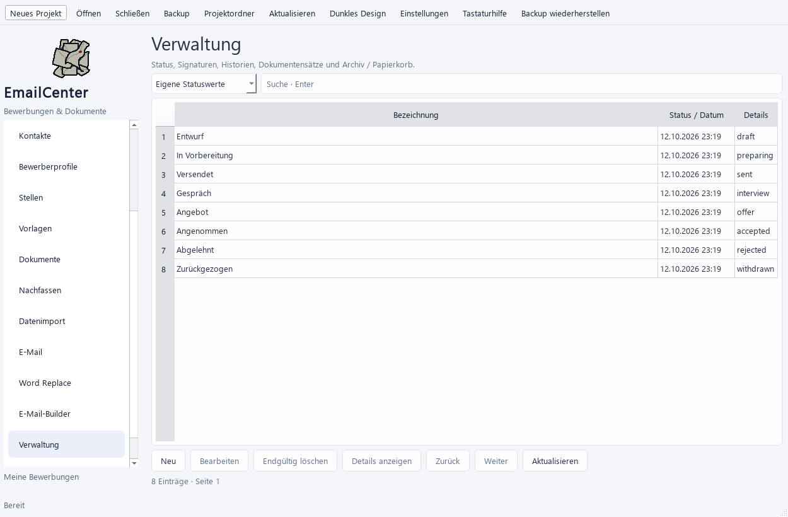
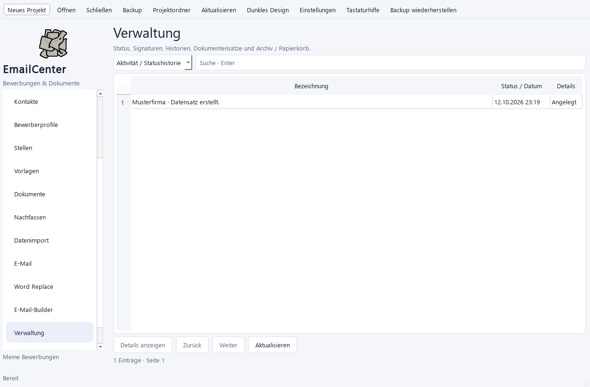
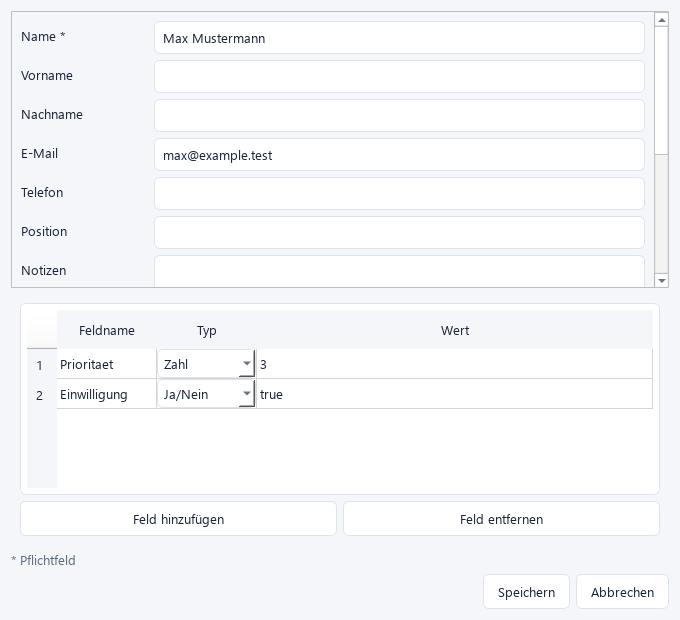

# Abschluss A1–A3 – Umsetzung und Sammelabnahme

Stand: 12.10.2026. Zuordnung: Sprint 3/4/5/7, zusätzlich Dateibereinigung in
Sprint 8. Projektanlage wartet bei kurzzeitigen Windows-Sperren begrenzt;
bestehende Ziele und dauerhafte Fehlermeldungen bleiben erhalten. Prüfbericht: [601 Tests und echte lokale Nachweise](36_Completion_Test_Report.txt).
Codesicherung mit Prüfsummen: [Archivnachweis](abnahme/Code_Snapshot.json).
Verbindliche Gesamtliste: [Finale TODO](34_Final_TODO.md).

## Was jetzt umgesetzt ist

| Bereich | Funktionen |
| --- | --- |
| A1 – Dokumente | LibreOffice automatisch finden; echte PDF-Konvertierung mit kurzem, isoliertem Profil und atomarer Veröffentlichung auch auf einem anderen Laufwerk; persönliche Word-Dokumente, PDF-Seitenlayout im Builder vor Gruppenanlage |
| A2 – Builder | 26 Bausteinarten; Auswahl als Bausteingruppe speichern/einfügen/löschen; IDs neu vergeben und Quellen neu zuordnen; Inline-Bilder mit persönlichen Pfaden/Alternativtexten; Anhangnamen mit Datenfeldern und Reihenfolge; Undo/Redo |
| A3 – Stammdaten | Adressen für Unternehmen/Kontakte/Profile; typisierte individuelle Zusatzfelder; Stellenbeginn mit Datumsprüfung; unveränderte strukturierte Altwerte erhalten |
| A3 – Verwaltung | Eigene Statuswerte; bestehende Signaturen samt Standardsignatur bearbeiten; Aktivitäts-/Statusverlauf; Dokumentensätze mit Varianten/Herkunft und Öffnen; Exporthistorie mit Prüfsummen und Dateiöffnung |
| A3 / Sprint 8 – Lebenszyklus | Archiv/Papierkorb/Wiederherstellen/endgültig löschen; Konfliktprüfung, Referenzschutz inklusive gespeicherter JSON-Quellen; sichere Dateibereinigung mit dauerhaftem Nachweis und erneutem Versuch nach Sperren/Neustart |

Die Verwaltung ist bei geöffnetem Projekt in der Navigation verfügbar. Längere
Datei-, Datenbank- und Konvertierungsaufgaben laufen über den vorhandenen Worker.

## A1 bedienen und prüfen

1. Unter Einstellungen → Word Replace kann der Konverterpfad leer bleiben:
   installierte LibreOffice-Versionen werden zuerst gesucht. Für dieses lokale
   Entwicklungsprojekt steht zusätzlich `.tools/libreoffice/program/soffice.com`
   bereit; keine systemweite Installation wurde vorgenommen.
2. Word Replace: Original-DOCX und Datenquelle auswählen, Regeln zuordnen,
   Vorschau prüfen und persönliche DOCX/PDF-Kopien erzeugen.
3. Im Builder DOCX → Word Replace → PDF verbinden. Am DOCX-/Word-Replace-/PDF-
   Baustein „Seitenlayout (PDF) vorschauen“ wählen. Diese Vorschau erzeugt keine
   Entwurfsgruppe und versendet nichts. Automatisches Laden bleibt bei der
   günstigeren Text-/Medienvorschau; die tatsächliche Konvertierung startet bewusst.

**Lokaler Nachweis:** Zwei echte PDFs mit je zwei Seiten. Alle vier Seiten wurden
visuell geprüft: persönliche Namen/Firmen/E-Mail-Werte, Logo, Tabelle, Formatierung,
Kopf-/Fußzeilen und expliziter Seitenumbruch. Das Original blieb unverändert.
Eine echte XLSX-Datei wurde importiert; ihre persönlichen Word-Ausgaben sind
per SHA-256 identisch mit den PDF-geprüften Ausgaben der manuellen Liste.
Pause/Fortsetzen, Abbruch vor Konvertierung und Schutz eines nachträglich
geänderten Ausgabeziels wurden am lokalen Service geprüft.

- [Ergebnis A1](abnahme/A1_Layout/Ergebnis.json)
- [PDF Max Mustermann](abnahme/A1_Layout/Projekt/exports/layout_checked/Anschreiben-001-Max%20Mustermann.pdf)
- [PDF Erika Musterfrau](abnahme/A1_Layout/Projekt/exports/layout_checked/Anschreiben-002-Erika%20Musterfrau.pdf)

Die erste Konvertierung deckte eine Windows-Pfadgrenze im tief verschachtelten
LibreOffice-Profil auf. Das Profil verwendet nun einen kurzen temporären Pfad;
die Ausgabe wird separat auf dem Ziellaufwerk veröffentlicht. Busy-Profilreste
dürfen eine erfolgreiche Konvertierung nicht als Fehler darstellen.

## A2 bedienen und prüfen

1. Mehrere Bausteine auswählen → Übertragen → Auswahl als Bausteingruppe speichern.
   Einfügen übernimmt die internen Verbindungen in gleicher Reihenfolge und setzt
   Datenquellen zurück. Außenverbindungen anschließend bewusst herstellen.
2. „Inline-Bild“ mit dem Text-/HTML-Eingang der Mail verbinden; HTML auswählen.
   Optional Datenwerte verbinden und Pfad/Alternativtext personalisieren.
   Die Editorvorschau lädt ausschließlich registrierte lokale Bilder; entfernte
   Trackingbilder werden nicht nachgeladen. Die Versandkopie enthält das Bild als
   MIME-Teil mit Content-ID.
3. Datei/PDF → „Anhangname“ → Anhänge der Mail. Beispiel:
   `Anschreiben-{{company.name}}.pdf`. Fehlende Werte, Pfadzeichen, reservierte
   Namen oder eine geänderte Dateiendung sperren die Ausgabe.
4. Am Mailbaustein Anhänge auswählen und über Auf/Ab sortieren. Reihenfolge gilt
   für Vorschau und gespeicherte Kopien; Änderungen nehmen die alte Vorschaufreigabe zurück.

**Lokaler Nachweis:** Daten → Word Replace → echtes PDF → persönlicher Anhangname
und Inline-Bild → zwei lokale Entwürfe. Vor Gruppenanlage wurde eine echte PDF-
Layoutvorschau erzeugt. MIME-Dateien enthalten jeweils einen normalen PDF-Anhang
und ein eingebettetes Bild. Versandversuche: **0**.

- [Ergebnis A2](abnahme/A2_Builder/Ergebnis.json)
- [Layout vor Gruppenanlage](abnahme/A2_Builder/Vor_Gruppenanlage.pdf)
- [Reproduzierbares lokales Prüfszenario](abnahme/run_local_completion.py)

Ein synthetisches MJPEG-AVI wird im Qt-Editor tatsächlich dekodiert und liefert
Videobilder. Autoplay ist aus; beim Verlassen wird die Quelle freigegeben.
Das belegt dieses Format, keine allgemeine Codec-Kompatibilität.

## A3 bedienen und prüfen

- Adressen/Zusatzfelder direkt in den Erfassungs-/Bearbeitungsformularen pflegen.
  Zusatzfelder unterstützen Text, Zahl, Ja/Nein, Leer und Erhalt alter Strukturen.
- Verwaltung → Eigene Statuswerte / Signaturen: anlegen und bearbeiten. System-
  oder verwendete Statusregeln sind geschützt; Bezeichnung/Reihenfolge bleiben
  bearbeitbar. Genau eine Standardsignatur ist möglich. Konto verbinden/trennen
  erfolgt weiterhin auf der E-Mail-Seite; bevorzugtes Konto/Signatur in Settings.
- Verwaltung → Aktivität / Statushistorie: Änderungen und zugehörige Datensätze
  anzeigen. Dokumentensätze zeigen Originale/Varianten und deren Herkunft;
  vorhandene Varianten lassen sich öffnen.
- Verwaltung → Exporthistorie: Dateien, Anzahl, Größe und Prüfsumme anzeigen.
  Dateiöffnung prüft, ob der Export seitdem verändert wurde.
- Verwaltung → Archiv / Papierkorb: Datensatztyp und Zustand wählen. Archivierte
  Datensätze fehlen in aktiven Listen und neuen Auswahlfeldern. Wiederherstellen
  macht sie wieder aktiv. Endgültiges Löschen verlangt Bestätigung und sperrt
  bestehende Fremdschlüssel-/Quellenbezüge.

### Regeln für Dateien

Archiv/Papierkorb löschen keine Dokumentdateien. Endgültiges Löschen entfernt
nur unverwendete, unveränderte Dateien in den verwalteten Projektordnern
`documents`, `templates` und `exports`. Die aufgelösten Pfade müssen innerhalb
dieser Ordner bleiben. Externe Originale, unbekannte Dateien und Backups bleiben
erhalten. Bereits bestehende Aufträge und Quellen blockieren das Löschen.

Eine Dateisperre oder Unterbrechung hinterlässt einen dauerhaften
Bereinigungsnachweis. Verwaltung → Dateibereinigung → „erneut versuchen“ prüft
Pfad, Prüfsumme und Referenzen erneut. Zwischenzeitlich geänderte oder neu
zugeordnete Dateien bleiben erhalten. Das ist reguläres Löschen, kein garantiertes
Überschreiben aller Datenträgerkopien; Backup-Aufbewahrung bleibt A6.

## Zusätzlich erledigt – Recovery / Sprint 8

Das echte lokale Builder-Testprojekt wurde gesichert, die Archiv-Prüfsummen
wurden verifiziert und das Projekt in einen neuen Ordner wiederhergestellt.
Zwei lokale Entwürfe und ihre persönlichen PDF-/Bildanhänge sind erhalten;
Original- und wiederhergestellte Dateien stimmen per Prüfsumme überein.
Integritätsprüfung: `ok`; aktivierte Konten und Versandversuche: jeweils `0`.
Nachweis: [Backup-Ergebnis](abnahme/A2_Builder/Backup_Ergebnis.json).

Zusätzlich mit echten lokalen Dateien geprüft: Windows-Dateisperre verhindert
das Löschen; der Bereinigungsnachweis bleibt nach Neuöffnung erhalten und
die freigegebene Kopie wird beim erneuten Versuch entfernt. Beschädigte
Dokumenthashes und Abbruch veröffentlichen kein Restore-Projekt. Aufbewahrung
erhält geänderte und unbekannte Backups. Der tatsächliche Diagnoseexport
enthält keine persönlichen Testwerte, Nachrichten, Pfade oder Zugangsdaten.
Nachweise: [Recovery](abnahme/A6_Recovery/Ergebnis.json),
[Diagnose](abnahme/A2_Builder/Diagnose_Ergebnis.json).
Eine Abnahme mit einem eigenen produktiven Projekt bleibt A6.

Auch ein Schließfehler wurde behoben: Startet genau beim Schließen ein
Hintergrundvorgang, merkt sich die App den Schließwunsch, wartet auf dessen
Abschluss und sichert anschließend den Arbeitsstand. Neue Scheduler-Aufgaben
werden unterbunden. Bei einem Speicher-/Checkpointfehler wird das Schließen
angehalten und die App bleibt bedienbar.

## Ansichten

Qt-Ansichten aus dem lokalen Testlauf; keine native Windows-DPI-Abnahme:

## Gebündelte manuelle Abnahme

- [ ] Ein eigenes Anschreiben mit echten Tabellen/Bildern und Seitenumbrüchen
  aus Excel/manueller Liste erstellen; DOCX/PDF und Original vergleichen.
- [ ] Eigene Bilder, Videos und PDFs im Builder testen; fertige Mail und
  persönliche Anhangnamen/Reihenfolge im tatsächlichen Mailclient kontrollieren.
- [ ] Bausteingruppe speichern/einfügen, Undo/Redo, Neustart und erneutes Laden
  im nativen Windows-UI prüfen.
- [ ] Adressen/Zusatzfelder, Status-/Signaturbearbeitung, Export-/Dokumenthistorie
  und Archiv/Papierkorb/Restore mit einem eigenen Testdatensatz bedienen.
- [ ] Kleine Fenster und tatsächliche Windows-Skalierung/Tastaturbedienung prüfen.

Weitere reale Mails brauchen konkrete Freigabe. Die früher freigegebenen beiden
Gmail-Testmails wurden nicht erneut gesendet. A4–A7 und anschließend B1–B5 bleiben
in der [Gesamtliste](34_Final_TODO.md) geführt.
